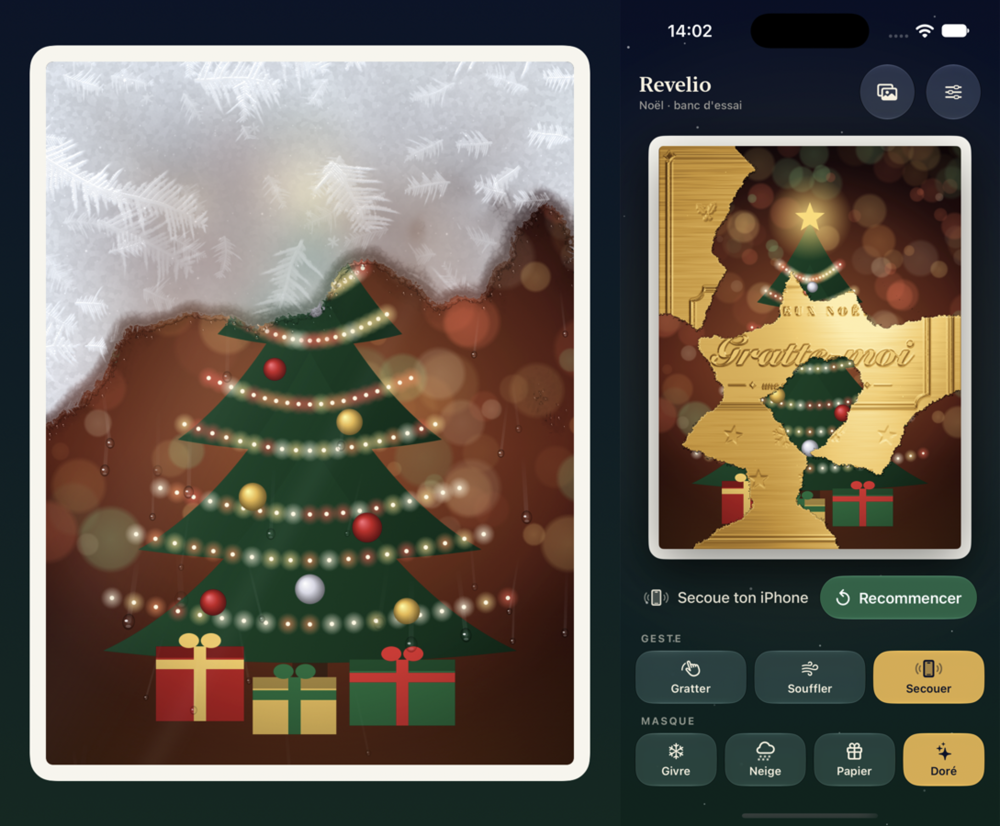

# Revelio · Magic Reveal

Prototype iOS pour **sentir sur iPhone** plusieurs façons de révéler une photo (ou une vidéo) cachée sous un masque de Noël. Ce n'est pas une app produit : c'est un banc d'essai, avec les réglages exposés pour comparer les sensations.



## Ce qu'on peut tester

Trois **gestes** et quatre **masques**, combinables librement (12 combinaisons) :

| Geste | Comment |
|---|---|
| **Gratter** | au doigt, pinceau doux le long du trait |
| **Souffler** | dans le micro : un front de révélation monte du bas de la carte |
| **Secouer** | chaque secousse fait tomber le masque par plaques |

| Masque | Rendu |
|---|---|
| **Givre** | vitre givrée (shader Metal), cristaux, liseré humide, gouttelettes |
| **Neige** | neige procédurale éclairée, paillettes, mottes qui tombent |
| **Papier** | papier cadeau découpé en morceaux (Voronoï) qui se déchirent et tombent |
| **Doré** | ticket à gratter en feuille d'or brossée, reflet qui suit l'inclinaison |

Au-delà d'un seuil (70 % par défaut), le reste du masque disparaît tout seul et la photo est célébrée (paillettes, haptique, carillon). Si le contenu est une vidéo, elle démarre à la révélation.

Retours **haptiques** (Core Haptics) et **sons procéduraux** (`AVAudioEngine`) propres à chaque masque et à chaque geste.

## Lancer le projet

- Xcode 27, iOS 26 minimum, iPhone en portrait.
- Ouvrir `RevelioMagicReveal.xcodeproj`, schéma **RevelioMagicReveal**.
- Le souffle et la secousse ont besoin d'un vrai iPhone. En simulateur, le panneau de debug a une zone **Maintenir : simuler** qui injecte le geste courant tant qu'on appuie, et ⌃⌘Z déclenche une secousse.

Tests (Swift Testing, logique pure) :

```bash
xcodebuild test -scheme RevelioMagicReveal -destination 'platform=iOS Simulator,name=iPhone 18 Pro'
```

## Détection du souffle

Le micro est lu en mode « mesure » (sans traitement du système), par blocs de ~40 ms analysés par FFT : niveau, harmonicité, part des graves et des aigus, centre du spectre. Le mode **Signature du souffle** (par défaut) ne réagit qu'à un bruit d'air chargé en graves, sans hauteur de note et soutenu 120 ms : la voix, le chant et les « sss » sont ignorés. Le mode **Volume seul** réagit à tout son assez fort.

- **Micro** : celui du haut, côté écran, par défaut (on souffle vers l'écran) ; celui du bas en option. Le mode « mesure » ne donne qu'un micro à la fois.
- **Réglages** : seuil en dB, vitesse, choix du micro.
- **Mode debug** : mesures en direct, verdict, et prises étiquetées de 5 s (WAV + CSV) enregistrées dans Documents, partageables par AirDrop.
- `scripts/analyse-souffle.py` rejoue la détection sur ces CSV pour régler les seuils ; les prises de référence sont dans `RevelioMagicRevealTests/Fixtures`.

## Organisation du code

```
RevelioMagicReveal/
  App/        point d'entrée, modèle, médias, options de lancement
  Core/       RevealEngine (état, avancé par CADisplayLink), carte de couverture, particules
  Input/      micro (analyse du souffle, enregistrements), mouvement
  Masks/      un dossier par masque (rendu, particules) + célébration
  Shaders/    shaders Metal [[stitchable]] (givre, neige, doré)
  Feedback/   haptique, synthèse sonore, Jingle Bells, vibrations depuis un fichier audio
  UI/         écran principal, réglages, panneau de debug
```

Principe : les **gestes écrivent** dans une carte de couverture (grille de 0 à 1 qui ne fait que descendre) et les **masques la lisent** pour dessiner le rendu, les bords et les particules. Le détail est dans [docs/specs/2026-10-02-revelio-noel-design.md](docs/specs/2026-10-02-revelio-noel-design.md).

## Scripts

| Script | Rôle |
|---|---|
| `scripts/demo-shot.sh` | construit, lance une démo scriptée en simulateur et prend une capture : `scripts/demo-shot.sh "iPhone 18 Pro" snow scratch partial /tmp/neige.png` |
| `scripts/make-sample-video.sh` | régénère la vidéo d'exemple embarquée |
| `scripts/analyse-souffle.py` | rejoue la détection du souffle sur des prises CSV |

Les arguments de lancement `-RNMask`, `-RNGesture`, `-RNDemo partial|finish` et `-RNDebug YES` permettent de vérifier un rendu sans geste réel.
